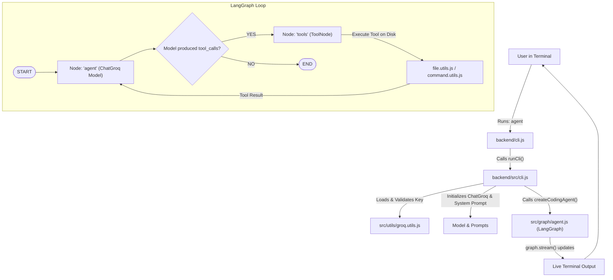

# Step-by-Step Code Walkthrough & Architecture Guide

This guide walks you through the entire codebase in the exact order you should read it to understand how this autonomous CLI coding agent works under the hood.

---

## 🗺️ High-Level Architecture

The system connects three layers:
1. **CLI Layer** (`cli.js` & `src/cli.js`): Terminal I/O, user prompts, approvals (`y/n/a`).
2. **LangGraph Agent Loop** (`src/graph/agent.js`): Cyclic state machine coordinating the LLM and tools.
3. **Tool Execution Layer** (`src/utils/file.utils.js` & `src/utils/command.utils.js`): Operations executed on disk.



---

## 📖 Step-by-Step Reading Order

To understand the codebase completely, open and read the files in this exact sequence:

---

### Step 1: The Entry Point
📁 **File:** `backend/cli.js`

This is the executable script started when you run `agent` in your terminal.

- **What it does:**
  1. Sets up the Node.js shebang (`#!/usr/bin/env node`).
  2. Loads `.env` variables quietly.
  3. Imports and runs `runCli()` from `src/cli.js`.
  4. Catches unhandled top-level errors and sets exit code `1`.
- **Functions to inspect:**
  - `runCli().catch(...)`

---

### Step 2: Global Configuration & Authentication
📁 **Files:**
1. `backend/src/utils/constant.js`
2. `backend/src/utils/settings.utils.js`
3. `backend/src/utils/groq.utils.js`

Before doing anything, the agent needs an API key to communicate with Groq.

- **`constant.js`**:
  - Defines the default model: `"openai/gpt-oss-120b"`.
  - Defines Groq models API URL: `https://api.groq.com/openai/v1/models`.
- **`settings.utils.js`**:
  - `getSavedApiKey()`: Reads the user's saved Groq key from global config (`%APPDATA%\coding-agent\settings.json` on Windows).
  - `saveApiKey()`: Persists the API key so the user only has to enter it once.
- **`groq.utils.js`**:
  - `isGroqApiKeyValid(apiKey)`: Sends a lightweight `fetch()` to Groq to verify that the key is valid (checks for `401 Unauthorized`).

---

### Step 3: The Toolset (What the Agent Can Do)
📁 **Files:**
1. `backend/src/utils/file.utils.js`
2. `backend/src/utils/command.utils.js`

These files define the capabilities exposed to the LLM via **LangChain**'s `tool()` helper.

#### `file.utils.js`
- **`resolveSafePath(workspace, requestedPath)`**:
  - Ensures any path requested by the LLM stays strictly inside the workspace.
  - Rejects attempts to escape (`../../`) or modify protected items (`.git`, `.env`, `node_modules`).
- **`createFileTools(workspace, confirmAction)`**:
  - Returns LangChain tools wrapped with **Zod** validation schemas:
    1. `list_files`: Lists directory contents.
    2. `read_file`: Reads UTF-8 file content.
    3. `make_directory`: Recursively creates folders on disk.
    4. `write_file`: Writes content to files (creates missing parent folders automatically).
    5. `edit_file`: Replaces exact strings inside an existing file.
    6. `delete_file`: Deletes files or folders with confirmation.

#### `command.utils.js`
- **`runWorkspaceCommand(command, workspace)`**:
  - Spawns shell processes (`npm`, `node`, `git`, etc.) in the workspace directory.
  - Streams `stdout` and `stderr` live to the user's terminal.
  - Strips `GROQ_API_KEY` from environment variables so child processes cannot access secrets.
- **`createCommandTool(workspace, confirmCommand)`**:
  - Exposes the `execute_command` tool to LangChain with parameter validation.

---

### Step 4: The Core Brain (LangGraph State Machine)
📁 **File:** `backend/src/graph/agent.js`

This is where **LangGraph** orchestrates the decision-execution loop.

- **Function to inspect:** `createCodingAgent({ model, workspace, confirmWrite, confirmCommand })`
  - **Tool Binding (LangChain):**
    ```javascript
    const modelWithTools = model.bindTools(tools);
    ```
    Binds the file and command tools to the model using the OpenAI tool-calling schema.
  - **Graph Definition (LangGraph):**
    ```javascript
    return new StateGraph(MessagesAnnotation)
      .addNode("agent", async (state) => ({ messages: [await modelWithTools.invoke(state.messages)] }))
      .addNode("tools", new ToolNode(tools))
      .addEdge(START, "agent")
      .addConditionalEdges("agent", (state) => state.messages.at(-1)?.tool_calls?.length ? "tools" : END)
      .addEdge("tools", "agent")
      .compile();
    ```
  - **How the cycle works:**
    1. `START` goes to `agent` (calls model with conversation messages).
    2. If the model returned `tool_calls`, route to `tools`.
    3. `ToolNode(tools)` executes the tools on disk and creates `ToolMessage` results.
    4. `tools` routes back to `agent`, allowing the model to see the output and decide its next step.
    5. Once the model outputs a plain text answer (no more tools needed), it routes to `END`.

---

### Step 5: The Interaction & Streaming Engine
📁 **File:** `backend/src/cli.js`

This file handles user interaction, flags, approvals, and real-time streaming.

- **Functions & Flow in `runCli()`:**
  1. **Argument Parsing:** Checks for `-y` (auto-approve), `-h` (help), or a custom workspace directory.
  2. **`buildSystemPrompt(workspace)`:** Crafts the system prompt directing the agent to take direct action via tools rather than just printing markdown code.
  3. **`requestApproval(prompt)`:** Prompts the user with `[y/N/a(all)]`:
     - `y`: Approves this specific action.
     - `a`: Switches `session.autoApprove = true` for the rest of the session.
     - `n`: Cancels the tool call.
  4. **`confirmWrite` & `confirmCommand`:** Callbacks passed to tools to gate destructive actions.
  5. **REPL Loop (`while (true)`):**
     - Reads user input with `rl.question("agent> ")`.
     - Handles slash commands: `/auto`, `/status`, `/clear`, `/help`, `/exit`.
     - Converts user input into `new HumanMessage(input)`.
     - Calls **`graph.stream(...)`**:
       - When `chunk.agent` emits `tool_calls`: Prints `🤖 [Agent Action] Tool: make_directory...`.
       - When `chunk.tools` emits results: Prints `✓ Successfully created directory...`.
       - When the agent finishes: Prints the final markdown answer.

---

## 🔍 Concrete Trace: What Happens When You Ask Something

Let's trace what happens when you type:
> *"make a folder named src, inside it create app.js with console.log('hello world'), and test it with node"*

| Step | Component | Action |
| :--- | :--- | :--- |
| **1** | `src/cli.js` | Receives text, creates `HumanMessage`, and calls `graph.stream()`. |
| **2** | LangGraph (`agent` node) | Calls ChatGroq. Model decides to call `make_directory` and `write_file`. |
| **3** | `src/cli.js` | Detects `tool_calls` in stream, prints: `🤖 [Agent Action] Tool: make_directory`. |
| **4** | LangGraph (`tools` node) | Executes `make_directory({ path: "src" })` in `file.utils.js`. Directory is created. |
| **5** | LangGraph (`tools` node) | Triggers `write_file({ path: "src/app.js", ... })`. Prompts user for approval `[y/N/a]`. |
| **6** | `src/cli.js` | User presses `y` (or auto-approves). File `src/app.js` is written to disk. |
| **7** | LangGraph (Cyclic Edge) | Routes tool outputs back to `agent` node. |
| **8** | LangGraph (`agent` node) | Model sees files are written. It now emits `execute_command({ command: "node src/app.js" })`. |
| **9** | `src/utils/command.utils.js` | Executes `node src/app.js`, captures `hello world`, returns exit code 0. |
| **10** | LangGraph (`agent` node) | Model sees success output, produces final text response with no more tool calls. |
| **11** | LangGraph (`ConditionalEdge`) | Routes to `END`. |
| **12** | `src/cli.js` | Prints final summary to user: *"Created folder src, wrote app.js, and executed it successfully."* |

---

## 💡 Summary Cheat-Sheet

| If you want to understand... | Read this file first |
| :--- | :--- |
| How the agent starts & flags (`-y`) work | [backend/cli.js](file:///d:/Cohort%203.0/Backend/Generative%20AI/Gen%20AI%20-%20Tool%20calling/backend/cli.js) & [backend/src/cli.js](file:///d:/Cohort%203.0/Backend/Generative%20AI/Gen%20AI%20-%20Tool%20calling/backend/src/cli.js) |
| How LangGraph controls the decision loop | [backend/src/graph/agent.js](file:///d:/Cohort%203.0/Backend/Generative%20AI/Gen%20AI%20-%20Tool%20calling/backend/src/graph/agent.js) |
| How tools modify files safely | [backend/src/utils/file.utils.js](file:///d:/Cohort%203.0/Backend/Generative%20AI/Gen%20AI%20-%20Tool%20calling/backend/src/utils/file.utils.js) |
| How shell commands are executed | [backend/src/utils/command.utils.js](file:///d:/Cohort%203.0/Backend/Generative%20AI/Gen%20AI%20-%20Tool%20calling/backend/src/utils/command.utils.js) |
| How API keys are validated & stored | [backend/src/utils/settings.utils.js](file:///d:/Cohort%203.0/Backend/Generative%20AI/Gen%20AI%20-%20Tool%20calling/backend/src/utils/settings.utils.js) & [backend/src/utils/groq.utils.js](file:///d:/Cohort%203.0/Backend/Generative%20AI/Gen%20AI%20-%20Tool%20calling/backend/src/utils/groq.utils.js) |
